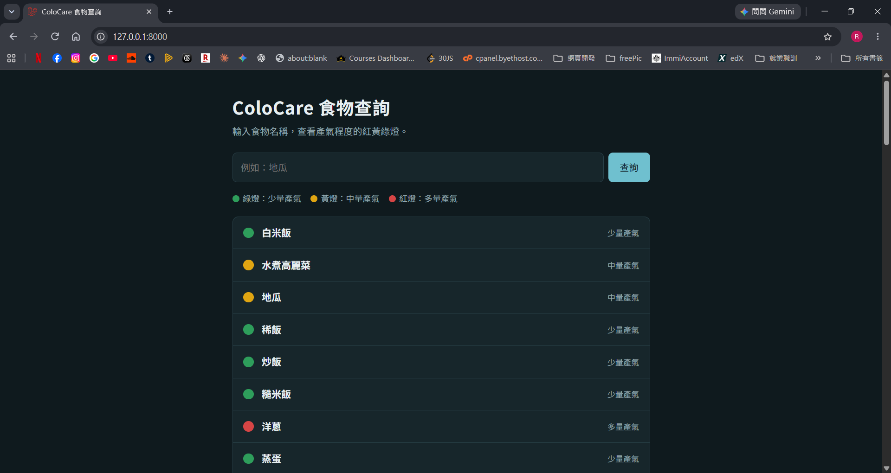
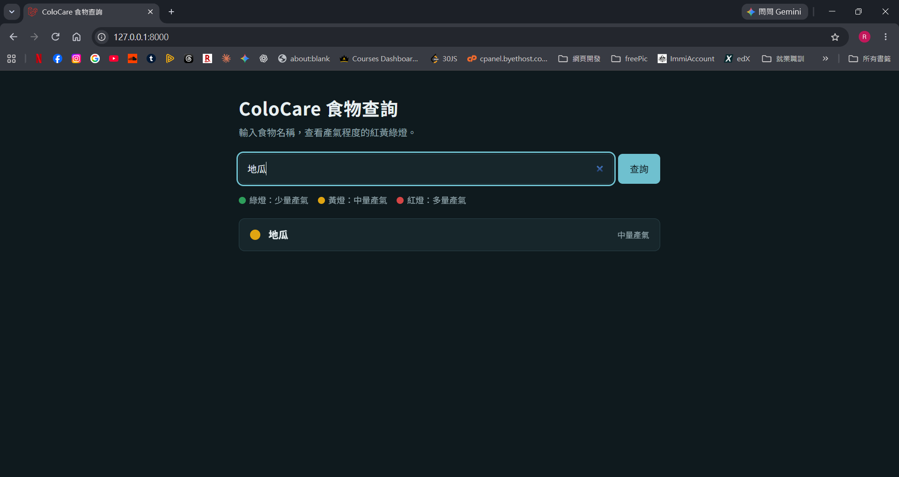

# ColoCare 食材查詢 API

以 Laravel 建立的 REST API 與查詢頁面：輸入關鍵字查詢食材，回傳產氣等級，並為每一筆食材標示紅黃綠燈。

本專案源自課程專題「ColoCare 大腸癌術後階梯式飲食管理系統」，這個儲存庫只實作其中的食材查詢功能，作為後端作品集練習。

## 免責聲明

這是教學與作品集專案，**不是醫療建議**。食材的產氣分類整理自公開的衛教資料，燈號規則為自行設定的簡化示範，不可作為飲食或醫療決策依據。

## 畫面預覽





## 資料來源

產氣分類參考 mygutcare.com.au 的 Low Gas Producing Food Chart（EAT、LIMIT、AVOID 三類），食材名稱為自行翻譯成中文。僅供學習展示。

早期的示範資料（白米飯、地瓜等）另有粗纖維與脂肪比率欄位，新匯入的食材這兩個欄位為空值（`null`）。

## 使用技術

- PHP 8、Laravel
- MySQL（開發環境：XAMPP）
- 前端：Blade 模板搭配原生 JavaScript（`fetch` 呼叫 API）

## 安裝與執行

```bash
git clone https://github.com/rouxchencode/colocare-api.git
cd colocare-api
composer install
cp .env.example .env
```

編輯 `.env`，填入資料庫設定（資料庫名稱 `colocare`，需先在 MySQL 建立）：

```
DB_CONNECTION=mysql
DB_HOST=127.0.0.1
DB_PORT=3306
DB_DATABASE=colocare
DB_USERNAME=root
DB_PASSWORD=
```

接著執行：

```bash
php artisan key:generate
php artisan migrate
php artisan db:seed --class=FoodSeeder
php artisan serve
```

- 網頁：`http://127.0.0.1:8000/foods`
- API：`http://127.0.0.1:8000/api/foods`

`FoodSeeder` 使用 `updateOrInsert`，重複執行不會產生重複的食材。

## API

### GET /api/foods

查詢食材，可用關鍵字篩選。

| 參數 | 必填 | 說明 |
|------|------|------|
| keyword | 否 | 食材名稱包含的文字；不帶則回傳全部 |

範例：

```
GET /api/foods?keyword=飯
```

回傳（JSON 陣列，每筆為一項食材，範例僅示意格式）：

```json
[
  {
    "id": 4,
    "food_name": "稀飯",
    "crude_fiber": "0.10",
    "fat_ratio": "0.10",
    "gas_label": 0,
    "created_at": null,
    "updated_at": null,
    "light": "green"
  }
]
```

`crude_fiber` 與 `fat_ratio` 在後來匯入的食材中為 `null`。沒有符合的資料時回傳空陣列 `[]`。

### 燈號規則（教學示範）

燈號只看 `gas_label`：

| gas_label | 產氣程度 | 燈號 |
|-----------|----------|------|
| 0 | 少量產氣（EAT） | green |
| 1 | 中量產氣（LIMIT） | yellow |
| 2 | 多量產氣（AVOID） | red |

燈號在 API 回傳時即時計算，不存在資料庫中。

## 資料表

資料表名稱為 `food`（Laravel 依 Model 名稱 `Food` 自動推得，採用框架預設命名）。

| 欄位 | 型態 | 說明 |
|------|------|------|
| id | bigint | 主鍵 |
| food_name | varchar(100) | 食材名稱 |
| crude_fiber | decimal(5,2)，可為空 | 粗纖維（g / 100g） |
| fat_ratio | decimal(5,2)，可為空 | 脂肪比率（%） |
| gas_label | tinyint | 產氣等級：0 少量、1 中量、2 多量 |
| created_at / updated_at | timestamp | 建立與更新時間 |

資料表結構以 migration 管理，執行 `php artisan migrate` 即可建立或更新。

## 未來規劃

- 補上食品營養成分資料（粗纖維、脂肪等）
- 查詢結果加入分頁
- 新增食材端點與認證（Laravel Sanctum）
- 依術後階段（phase）調整燈號規則

## 作者

Roux

## 部署到 Ubuntu(Nginx + PHP-FPM + MySQL)

已在 Ubuntu 26.04(WSL2)上完成部署驗證。

1. 安裝套件:
   `sudo apt install -y nginx php-fpm php-mysql php-xml php-mbstring php-curl php-zip mysql-server composer git`
2. 建立資料庫與專用帳號(`sudo mysql`):
   ```sql
   CREATE DATABASE colocare CHARACTER SET utf8mb4 COLLATE utf8mb4_unicode_ci;
   CREATE USER 'colocare'@'localhost' IDENTIFIED BY '<你的密碼>';
   GRANT ALL ON colocare.* TO 'colocare'@'localhost';
   ```
3. 取得專案並安裝依賴:`git clone` 後執行 `composer install`、`cp .env.example .env`、`php artisan key:generate`,並在 `.env` 設定 `DB_*`
4. 建立資料表與範例資料:`php artisan migrate`、`php artisan db:seed --class=FoodSeeder`
5. 放到 `/var/www/colocare-api`,將 `storage` 與 `bootstrap/cache` 擁有者設為 `www-data`、權限 775
6. 設定 Nginx:`root` 指向專案的 `public`,所有請求導向 `index.php`,PHP 交給 php-fpm socket,並拒絕存取隱藏檔(`.env`、`.git`)
7. `sudo nginx -t` 檢查設定,`sudo systemctl reload nginx` 套用
8. 驗證:`curl -G "http://localhost/api/foods" --data-urlencode "keyword=番茄"`

### 部署時遇到的問題
- `curl` 網址直接放中文會 `Empty reply`,需用 `--data-urlencode` 編碼
- `.env` 的 `DB_*` 被 `#` 註解時 Laravel 讀不到,會連到預設的 sqlite
- Windows 的 XAMPP Apache 與 WSL 的 Nginx 同時佔用 80 埠,瀏覽器的 `localhost` 會先連到 XAMPP
